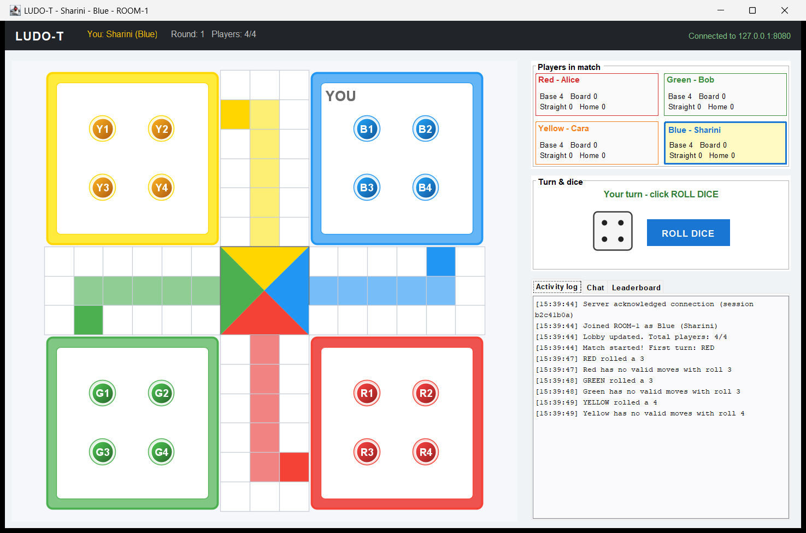
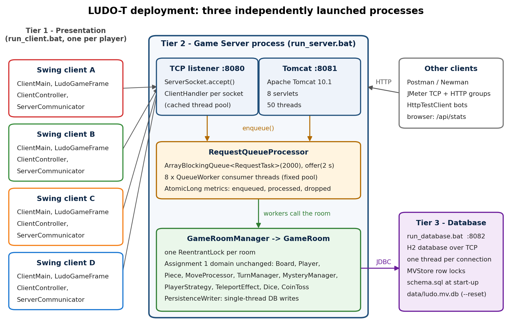

# LUDO-T: Multi-User Client-Server Ludo (Java)

A three-tier, multi-user version of "Ludo with a Twist" (mystery cells, colour strategies, three-sixes rule), built in **Java 21** for a university module on clean coding and concurrent programming (2026).



## Architecture

| Tier | Launcher | Port(s) | What it is |
|---|---|---|---|
| 3 · Database | `run_database.bat [port] [--reset]` | 8082 | H2 SQL server over TCP; schema applied on start |
| 2 · Game server | `run_server.bat` | 8080 TCP, 8081 HTTP | Socket listener + **embedded Apache Tomcat 10.1** servlets, bounded request queue with 8 workers, one `ReentrantLock` per room, JDBC connection pool |
| 1 · Client | `run_client.bat [host port name COLOUR]` | – | Swing / Java2D desktop client with dice animation, chat and leaderboard |



## Verification

| Check | Result |
|---|---|
| `test.bat`: JUnit 5 + Mockito | **280 / 280 passing** |
| Stress test, private server | 1,355 requests, 0 dropped |
| Live three tiers + stress bots | 2,141 bot requests; 4,172 enqueued = 4,172 processed, 0 dropped |
| Newman (Postman collection) | 20 requests, 38 assertions, 0 failures |
| JMeter | TCP + HTTP thread groups, `/api/stats` assertion |
| SonarQube / SonarLint | used to track cyclomatic and cognitive complexity during refactoring |

Raw logs are in [`docs/evidence/`](docs/evidence/).

## HTTP API (Tomcat, port 8081)

```
GET  /api/room/status?roomId=ROOM-1
POST /api/room/join      roomId, playerName, preferredColor   -> clientId
POST /api/room/leave     clientId
POST /api/game/roll      clientId                             -> dice value / 409 if not your turn
POST /api/game/move      clientId, piece
GET  /api/game/events?clientId=...[&waitMs=...]               -> pending events (async long-poll)
GET  /api/game/state?roomId=ROOM-1
GET|POST /api/chat
GET  /api/leaderboard
GET  /api/stats
```

## Running it

Requires Java 21 on the PATH (Windows batch launchers).

```bat
PLAY_GAME.bat            :: compiles, starts all three tiers and four client windows
test.bat                 :: compiles and runs the JUnit suite
run_stress_test.bat      :: socket bots against a private or running server
newman run Ludo_Postman_Collection.json
jmeter -n -t ludo_jmeter_test_plan.jmx
```

## Layout

```
src/ludo/        model, game engine, strategies (domain) + network, server, servlet, db, client, stress
src/test/ludo/   JUnit 5 tests
lib/             Tomcat embed core, Tomcat annotations API, H2 (runtime); lib/test/ JUnit, Mockito
docs/            report (PDF), figures, evidence logs, diagram scripts
```
